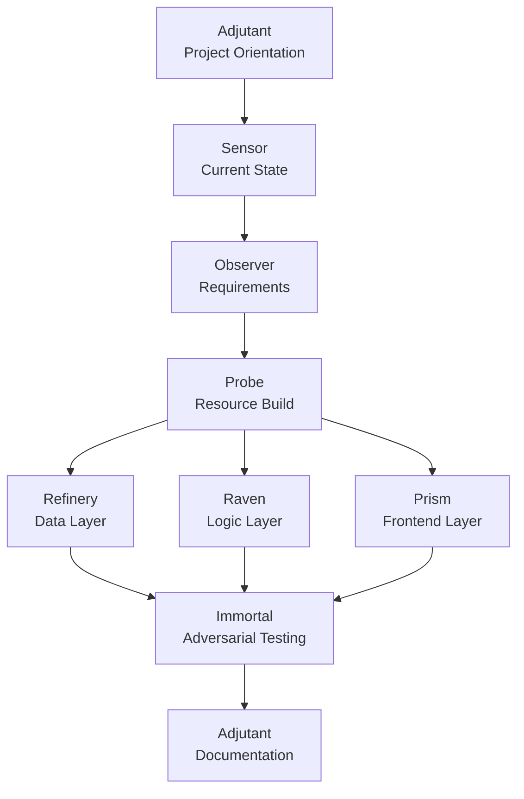

# NOVA Skill Suite — Nucleus Origination Vitality Assistant for Software Development

8 specialized Claude Code Skills covering the full lifecycle of any software project — from requirement clarification to build, code review, data quality, testing, interface design, ongoing status monitoring, and documentation. Applicable to web systems, GUI applications, servers, databases, CLI tools, and embedded software. Each skill is self-contained and can be used independently, with no cross-skill file dependencies.

**English** | [繁體中文](./README.zh-TW.md)

---

## Prerequisites

- [Claude Code](https://claude.ai/code) CLI installed
- Access to the target project (source code, database, deployment environment, etc., depending on the task)
- Basic familiarity with software engineering concepts — **no platform- or framework-specific knowledge required**; works with any tech stack

---

## Installation

```bash
npx skills add github:q0015300153/nova-skills
```

**Verify** the installation:

```bash
npx skills list
```

All 8 `nova-*` skills should appear in the output.

**Update** to the latest version:

```bash
npx skills update nova-skills
```

**Remove:**

```bash
npx skills remove nova-skills
```

**Alternative — manual clone** (if you prefer to manage the files yourself):

```bash
git clone https://github.com/q0015300153/nova-skills.git
```

Then paste the content of any `skills/<skill-name>/SKILL.md` into the system prompt configuration of your AI assistant of choice.

---

## Skills

| Skill | Full Name | What it does                                                                                                                                                                                                                                         |
|---|---|------------------------------------------------------------------------------------------------------------------------------------------------------------------------------------------------------------------------------------------------------|
| `nova-observer` | Node Oracle Vector Assistant | Observer: When a request is ambiguous, walks through 11 key architecture decision dimensions and locks each one down before any code is written, preventing you from building on unstated assumptions.                                               |
| `nova-sensor` | Network Operations Visibility Assistant | Sensor: Re-scans the project's actual current state every single time, tracks only what's active or just changed, and tells the team exactly what to do next.                                                                                        |
| `nova-probe` | Nucleus Origination Vivification Assistant | Probe: From any requirement, constructs complete, runnable software components in strict dependency order (data store → domain model → business logic → interface → automation), always presenting a blueprint for approval before writing any code. |
| `nova-refinery` | Node Order Viability Assistant | Refinery: The data quality gatekeeper. Sets up strict health checks and quarantine handling to block corrupted, duplicate, or garbage data from breaking your system.                                                                                |
| `nova-raven` | Negentropy Optimization Vigilance Assistant | Raven: A merciless code review bot that hunts down inefficient, low-quality code and resource leaks, and forces optimization backed by real evidence.                                                                                                |
| `nova-prism` | Nuance Overlay Visualization Assistant | Prism: Designs interfaces with no dead ends and enforces a mandatory three-layer QA protocol (feature completeness, code correctness, UX completeness), ensuring nothing ships with a known bug.                                                     |
| `nova-immortal` | Node Ordeal Validation Assistant | Immortal: Designs and actually runs extreme test scenarios to actively try to "break" your system, ensuring it survives real-world conditions.                                                                                                       |
| `nova-adjutant` | Narrative Orientation Vault Assistant | Adjutant: Deciphers messy, hard-to-understand code and automatically translates it into clear documentation, comments, and onboarding guides that anyone can understand.                                                                             |

---

## Lifecycle Flow



---

## Design Principles

- **Resources are always referenced by a concrete identifier**: file paths, commit hashes, ticket IDs, table names, service names, etc. — always as inline code, never as vague generic labels (No Generic Placeholder Names).
- **No skill automatically invokes another**: `[WORKFLOW HANDOFF]` is advisory only — the human decides whether to switch to the next skill.
- **Every Dead Reckoning requires explicit user acknowledgment**, with all assumed values flagged — never silently assuming project state is unchanged.
- **Unconfirmed content is always flagged** with `[⚠️ INFERRED]`, never presented as established fact.
- **Every skill has a built-in cross-session ledger** (e.g. Vigilance Ledger, Decision Ledger, Build Ledger) that keeps tracking open items so nothing gets lost or re-reported across multiple conversation turns.

---

## Palantir Foundry Version

Looking for the same skill suite running on **Palantir Foundry / AIP**?
A Foundry-native port is maintained at **[q0015300153/eve-skills](https://github.com/q0015300153/eve-skills)**.

---

## Contributing

Pull requests are welcome. Each skill lives in `skills/<skill-name>/SKILL.md` and is fully self-contained — no cross-skill dependencies at runtime.

---

## License

[MIT](./LICENSE)
