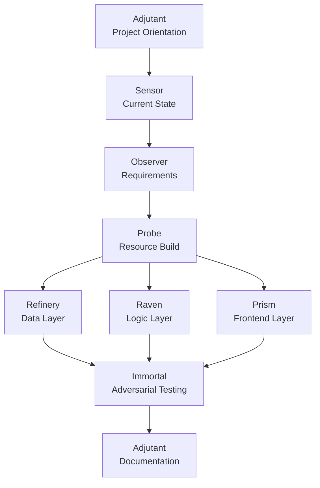
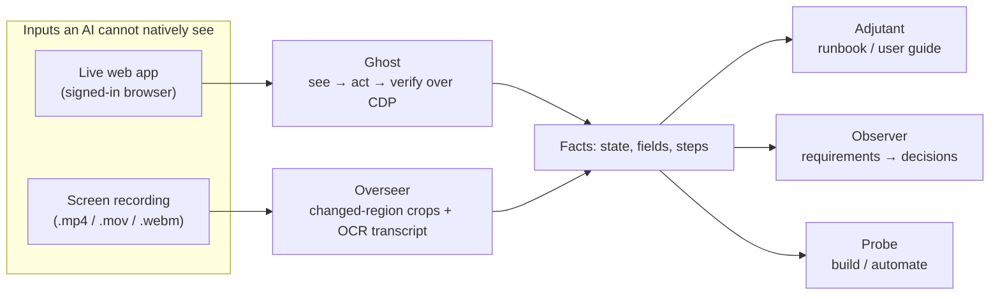
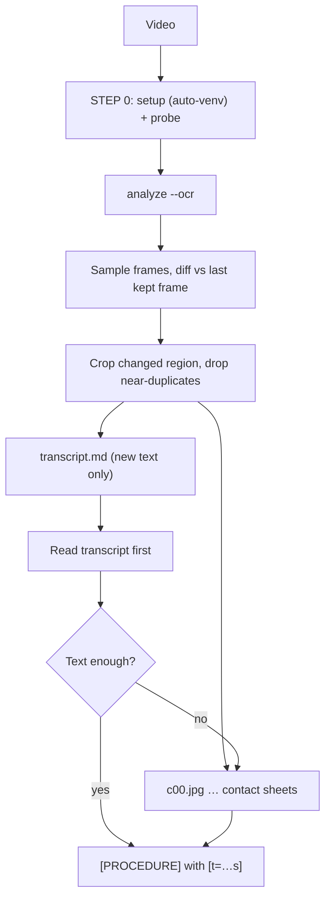
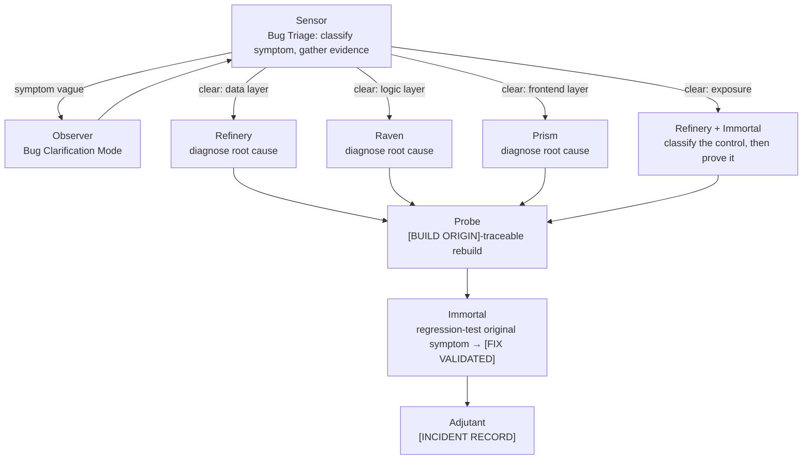

# NOVA Skill Suite — Nucleus Origination Vitality Assistant for Software Development

10 specialized Claude Code Skills covering the full lifecycle of any software project — from requirement clarification to build, code review, data quality, testing, interface design, ongoing status monitoring, bug triage, cross-resource cleanup, data governance, and documentation — plus two **senses** that let an AI work with what it cannot natively see: a live browser (`nova-ghost`) and screen recordings (`nova-overseer`). Applicable to web systems, GUI applications, servers, databases, CLI tools, and embedded software. Each skill is self-contained and can be used independently — no skill requires another to be installed.

**English** | [繁體中文](./README.zh-TW.md)

---

## Prerequisites

- [Claude Code](https://claude.ai/code) CLI installed
- Access to the target project (source code, database, deployment environment, etc., depending on the task)
- *Only for the two tool-backed skills* (installed automatically on first use, nothing global): **Node.js 18+** for `nova-ghost`; **Python 3.9+** for `nova-overseer`
- Basic familiarity with software engineering concepts — **no platform- or framework-specific knowledge required**; works with any tech stack

---

## Installation

```bash
npx skills add github:q0015300153/nova-skills
```

**Verify** the installation:

```bash
npx skills list
```

All 10 `nova-*` skills should appear in the output.

**Update** to the latest version:

```bash
npx skills update nova-skills
```

**Remove:**

```bash
npx skills remove nova-skills
```

**Alternative — manual clone** (if you prefer to manage the files yourself):

```bash
git clone https://github.com/q0015300153/nova-skills.git
```

Copy the whole `skills/<skill-name>/` folder (not just `SKILL.md`) into your assistant's skills directory. Five skills ship supporting files that `SKILL.md` calls by path — `nova-ghost` and `nova-overseer` include `scripts/` (executable tools that self-install) and `references/`; `nova-adjutant`, `nova-sensor` and `nova-probe` keep long templates or protocols in `references/` and read them on demand. Pasting only `SKILL.md` text into a system prompt leaves those skills without their files. The other five skills are single-file.

---

## Skills

| Skill | Full Name | What it does |
|---|---|---|
| `nova-observer` | Node Oracle Vector Assistant | The Observer: When a request is ambiguous, classifies 11 architecture decision dimensions into **already answered by the project** (read from `docker-compose.yml`, schema files, CI config, existing ADRs), **genuinely blocking** (a full A/B/C question), and **safely default-able** (one line you override in one word) — so it never asks about something the repo already states. When a reported bug's symptom is too vague, switches to **Bug Clarification Mode**, working through 8 dimensions, inferring what git log and the stack trace already settle, before routing it to the right specialist or back to `nova-sensor`. |
| `nova-sensor` | Network Operations Visibility Assistant | The Sensor: Re-scans the project's actual current state every single time, tracks only what's active or just changed, collapses unchanged items to one line, and tells the team exactly what to do next — presenting real choices with their consequences rather than a single dictated action. **Aggregates every other skill's open items by reading the files they write**, which is what makes tracking work across sessions. Adds **whole-project cross-resource cleanup scanning** (unused files, tables, API endpoints, dependencies, and more) and **Bug Triage**, routing problems to the right specialist based on real evidence rather than the symptom description alone. |
| `nova-probe` | Nucleus Origination Vivification Assistant | The Probe: From any requirement, constructs complete, runnable software components in strict dependency order (data store → domain model → business logic → interface → automation), always presenting a blueprint for approval before writing any code. The confirmed blueprint is **written to `docs/build/<target>-blueprint.md`**, where its per-tier Status column doubles as the build record a later session can resume from. Includes only the fields the stated use case **actually needs** by default (Use Case Scoping), intercepting sensitive fields for explicit confirmation (`[DATA EXPOSURE REVIEW]`); bug-driven rebuilds retain full traceability (`[BUILD ORIGIN]`); delivers one tier at a time by default, with a "CONFIRMED — ALL AT ONCE" override. |
| `nova-refinery` | Node Order Viability Assistant | The Refinery: The data quality **and** exposure gatekeeper — every response opens with **two independent verdicts**: is this data safe to rely on, and is it safe to expose. Sets up strict health checks and quarantine handling to block corrupted, duplicate, or garbage data, traces every violation to the entry point that let it in, and runs a formal **sensitivity classification and access-control recommendation workflow** (`[SECURITY CLASSIFICATION REVIEW]`). The schema contract and every classification decision are **written to `docs/data/<target>-contract.md`** — a compliance decision that lives only in a chat log cannot be audited. |
| `nova-raven` | Negentropy Optimization Vigilance Assistant | The Raven: A merciless code review bot that hunts down inefficient, low-quality code and resource leaks, and forces optimization backed by real evidence. Re-reads the cited `file:line` before claiming a finding is recurring, resolved, or regressed — a refactor moves line numbers, and a stale citation makes a live bug look fixed. Applies one root cause at a time, reports **changed lines only, never a whole file**, and keeps its finding history in `docs/review/<target>-findings.md`. Investigations continuing from a bug triage retain **origin traceability** through to final validation and recording. |
| `nova-prism` | Nuance Overlay Visualization Assistant | The Prism: Designs interfaces with no dead ends and enforces a mandatory three-layer QA protocol (feature completeness, code correctness, UX completeness), ensuring nothing ships with a known bug. **Complete manual configuration guides** for no-code/low-code builder tools are written to `docs/ui/<surface>-config.md` and rewritten in full there on every update — the chat reports only which fields changed, never a re-paste. Runs a **sensitive field exposure check** before any field is wired into the interface, and says plainly that inspecting display logic never proves a control holds. |
| `nova-immortal` | Node Ordeal Validation Assistant | The Immortal: Designs and actually runs extreme test scenarios across **eight categories** — including **Authorization & Data Exposure**, which requests protected data as a role that should be denied and asserts the value is *absent from the response*, not merely hidden from view, across every access path (UI, API, export, logs). Automatable scenarios are committed as real test files so the gate is re-runnable; the gate's standing state and every accepted risk go in `docs/testing/GATE.md`. When a regression test confirms a previously reported bug is actually fixed, formally records it as **`[FIX VALIDATED]`** and hands it off for filing. |
| `nova-adjutant` | Narrative Orientation Vault Assistant | The Adjutant: Deciphers messy, hard-to-understand code and translates it into clear documentation, comments, and onboarding guides — **written into the repository**, not pasted into the chat. Re-reads both the existing doc and the code it describes before claiming drift, so a stale doc is flagged rather than quietly overwritten. Adds **Incident Record**, formally preserving the symptom, root cause, fix, regression test, and recurrence risk for every resolved bug in `INCIDENTS.md`, checking for a recurrence of a known cause before filing a new one. |
| `nova-ghost` | Nimble Operative Vision Assistant | The Ghost: Lets an AI drive a real, already-signed-in Chromium browser through a local Chrome DevTools Protocol bridge — no Selenium or Playwright. Checks the bridge and the signed-in account before acting, works in a strict **see → act → verify** loop, prefers DOM operations over coordinates, and hands control back to the human at login, MFA, and any irreversible step. Never reads cookies or tokens. Ships `scripts/ensure-browser.mjs` (auto-detects or launches a dedicated debug browser) and `scripts/cdp.mjs` plus a setup and troubleshooting reference; use it for automation, web-UI development, and browser-based testing. |
| `nova-overseer` | Neural Observation Video Assistant | The Overseer: Lets an AI understand a **screen recording** (demo, how-to, bug repro, process walkthrough) at a fraction of the usual token cost. Instead of sampling a frame per second, it keeps only the **screen region that changed** at each moment, drops near-duplicates, and packs the crops into a few contact sheets plus an optional **OCR transcript with repeated text removed** — a 5-minute recording becomes a handful of images and a short text file. Installs its own isolated toolchain (private venv under `~/.nova-overseer`, no admin, nothing global) on first use. Reads the transcript before opening any image, cites every claim by timestamp, marks OCR-only digits `[⚠️ OCR ONLY]`, and never transcribes a password, code, or personal address it sees. Ships `scripts/overseer.py`, a smoke-test generator, and a tuning reference. |

---

## Where each skill writes

The skills produce durable artifacts in your repository. This is deliberate: anything whose entire value is being findable later cannot live in a conversation, and it is what allows `nova-sensor` to report on open items across sessions. Every path below follows your project's existing convention when one exists.

| Skill | Writes to |
|---|---|
| `nova-adjutant` | `README.md` · `docs/<module>.md` · `docs/api/<name>.md` · `docs/adr/NNNN-<slug>.md` · `docs/runbooks/<name>.md` · `docs/ONBOARDING.md` · `docs/flows/<scope>.md` · `docs/user-guides/<scope>.md` · `INCIDENTS.md` · inline docstrings |
| `nova-probe` | `docs/build/<target>-blueprint.md` — plus the generated source artifacts themselves |
| `nova-refinery` | `docs/data/<target>-contract.md` — plus validation/quarantine code in the file where it runs |
| `nova-raven` | `docs/review/<target>-findings.md` — plus the applied fixes |
| `nova-immortal` | `docs/testing/GATE.md` — plus committed test files |
| `nova-prism` | `docs/ui/<surface>-config.md` · `docs/ui/<surface>-qa.md` — plus component/style/test source |
| `nova-observer` | Nothing directly — routes its `[LOCKED DECISIONS]` to `nova-adjutant` to be recorded as an ADR |
| `nova-ghost` | Nothing — it operates the browser; any record it should leave goes through `nova-adjutant` |
| `nova-overseer` | Nothing in the repository — analysis output goes to a temp folder (it can contain customer data); the procedure it reconstructs is filed through `nova-adjutant` |
| `nova-sensor` | Nothing — read-only. It aggregates every file above |

A file that doesn't exist is never an error; it simply means that skill hasn't run against this project yet.

---

## Lifecycle Flow



---

## Senses: Browser & Video

`nova-ghost` and `nova-overseer` are not lifecycle stages — they are how the rest of the suite gets information it cannot read from source code. Either can feed any stage.



### Overseer pipeline



Typical use: `python skills/nova-overseer/scripts/overseer.py analyze demo.mp4 out --ocr`, then read `out/transcript.md` and only the sheets listed in `out/index.json` that the text cannot explain.

---

## Debug Workflow

When the situation is "something is broken" rather than "something new needs to be built," follow this path instead:



If the symptom can already be explained directly against `nova-sensor`'s own status scan (without needing to dig into a specific layer), `nova-sensor` resolves it directly with no unnecessary handoff. `nova-probe` is only invoked once a root cause has been diagnosed and a rebuild is genuinely needed — it is never the entry point for debugging.

---

## Cleanup & Data Governance

**Cross-resource cleanup division of labor**: `nova-sensor` handles whole-project, cross-resource-type scanning for unused resources (files, tables, API endpoints, dependencies, scheduled jobs, and more); `nova-prism` handles cleanup **within** a single UI surface (unused variables/components); `nova-probe` prevents over-building at the source through Use Case Scoping. All three only ever recommend — never auto-delete — and each recommendation states what deleting would break and what keeping it costs.

**Sensitive data protection chain** — four steps, each with a different job:

1. **`nova-probe`** detects potentially sensitive fields at build time using a shared Sensitivity Heuristic, producing a `[DATA EXPOSURE REVIEW]` with an explicit Include/Exclude decision per field.
2. **`nova-refinery`** performs a formal `[SECURITY CLASSIFICATION REVIEW]`, assigning a classification and a concrete access-control recommendation, recorded in the contract of record.
3. **`nova-prism`** runs one final `[⚠️ POTENTIAL SENSITIVE DATA]` check before a field is wired into a UI — and says so explicitly when all it can do is inspect display logic.
4. **`nova-immortal`** proves it, by requesting the value as a role that should be denied, through every access path. **A control's configuration never proves its effect** — steps 1–3 recommend and inspect; only step 4 verifies.

Every step requires explicit human confirmation before proceeding — nothing is silently let through.

---

## Design Principles

- **Resources are always referenced by a concrete identifier**: file paths, commit hashes, ticket IDs, table names, service names, etc. — always as inline code, never as vague generic labels (No Generic Placeholder Names).
- **State is read, not remembered.** Every skill runs a mandatory **STEP 0** before producing any output, re-establishing the state it is about to make claims about — branch and PR status, CI results, applied migrations, whether a recommended control is actually in place, what a prior audit recorded. What you created earlier in a conversation is not evidence of what is true now; people merge, deploy, and delete outside the session. Reporting less is a formatting choice; scanning less is a correctness failure.
- **Anything that must outlive the conversation is written to a file.** Blueprints, schema contracts, classification decisions, deployment gates, accepted risks, incident records, and finding histories all have a path in the repository. A ledger rendered into a chat log cannot be read next session, and a "locked" decision nobody wrote down gets silently re-assumed. Where a ledger's content is already carried by another section, it is dropped rather than duplicated.
- **No skill automatically invokes another**: `[WORKFLOW HANDOFF]` is advisory only — the human decides whether to switch to the next skill. Every pointer carries the specific figure, cause, or gap the receiving skill needs, never a bare "needs testing".
- **Every Dead Reckoning requires explicit user acknowledgment**, with all assumed values flagged — never silently assuming project state is unchanged. STEP 0 still runs on whatever is readable.
- **`[⚠️ INFERRED]` and `[⚠️ VERIFY IN DOCS]` are kept explicitly distinct**: the former is a reasonable guess made from available project information; the latter is an actual framework/tool/platform behavior that needs to be confirmed against official documentation. The two are never conflated or used interchangeably.
- **Report what needs acting on.** Passing checks become a count, unchanged findings collapse to one line, and an unchanged deliverable is never re-pasted to communicate a one-field edit. But brevity never hides a gap: coverage is stated explicitly, and a new, critical, or regressed item is always expanded in full regardless of mode — `nova-refinery`, `nova-raven`, and `nova-prism` formalize this as SUMMARY/FULL modes.
- **Actions live in one place.** Anything only the user can do — apply, decide, deploy, confirm, verify — appears in a single `[NEEDS YOU]` list, never buried inside a findings table or a template. A finding diagnoses; it does not also carry a to-do list.
- **Sensitive data is never silently exposed**: across the four-step chain above, any field suspected of being sensitive requires explicit human confirmation, and an applied control is not considered proven until it has been adversarially tested.
- **Markdown integrity is part of correctness.** Every fence is closed, every table row has its full column count, every record is complete. These skills write into files that other people and other sessions read — a truncated table silently drops a field's rule, and a truncated ledger row loses an accepted risk.

---

## Palantir Foundry Version

Looking for the same skill suite running on **Palantir Foundry / AIP**?
A Foundry-native port is maintained at **[q0015300153/eve-skills](https://github.com/q0015300153/eve-skills)**.

---

## Contributing

Pull requests are welcome. Each skill lives in `skills/<skill-name>/` and is self-contained — no skill loads or depends on another's definition at runtime. `SKILL.md` holds the rules the assistant must always follow; long templates, command cheat-sheets and tuning tables go in `references/` and are read on demand; executable tools go in `scripts/` and must install themselves (no manual setup step). The only coupling between skills is observational: `nova-sensor` reads the artifact files the other skills write, and treats a missing file as "hasn't run yet" rather than an error. New skills follow the naming convention: a StarCraft unit name, a four-word backronym spelling N-O-V-A, and "The <Unit>" in the description.

---

## License

[MIT](./LICENSE)
