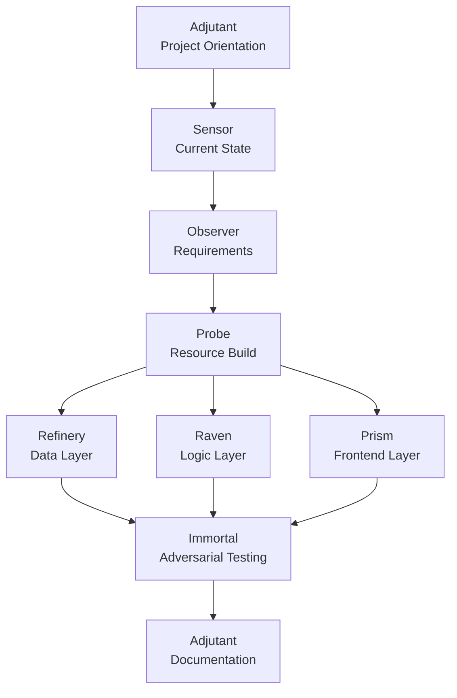
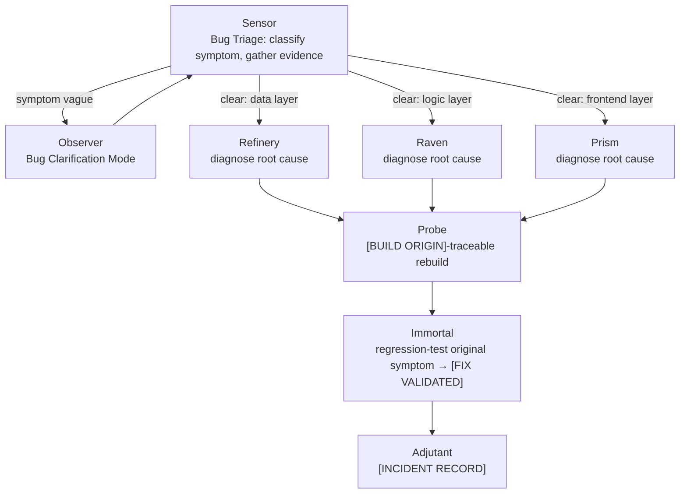

# NOVA Skill Suite — Nucleus Origination Vitality Assistant for Software Development

8 specialized Claude Code Skills covering the full lifecycle of any software project — from requirement clarification to build, code review, data quality, testing, interface design, ongoing status monitoring, bug triage, cross-resource cleanup, data governance, and documentation. Applicable to web systems, GUI applications, servers, databases, CLI tools, and embedded software. Each skill is self-contained and can be used independently, with no cross-skill file dependencies.

**English** | [繁體中文](./README.zh-TW.md)

---

## Prerequisites

- [Claude Code](https://claude.ai/code) CLI installed
- Access to the target project (source code, database, deployment environment, etc., depending on the task)
- Basic familiarity with software engineering concepts — **no platform- or framework-specific knowledge required**; works with any tech stack

---

## Installation

```bash
npx skills add github:q0015300153/nova-skills
```

**Verify** the installation:

```bash
npx skills list
```

All 8 `nova-*` skills should appear in the output.

**Update** to the latest version:

```bash
npx skills update nova-skills
```

**Remove:**

```bash
npx skills remove nova-skills
```

**Alternative — manual clone** (if you prefer to manage the files yourself):

```bash
git clone https://github.com/q0015300153/nova-skills.git
```

Then paste the content of any `skills/<skill-name>/SKILL.md` into the system prompt configuration of your AI assistant of choice.

---

## Skills

| Skill | Full Name | What it does |
|---|---|---|
| `nova-observer` | Node Oracle Vector Assistant | The Observer: When a request is ambiguous, walks through 11 key architecture decision dimensions and locks each one down before any code is written, preventing you from building on unstated assumptions. When a reported bug's symptom is too vague, switches to **Bug Clarification Mode**, working through 8 dimensions to pin the symptom down before routing it to the right specialist or back to `nova-sensor`. |
| `nova-sensor` | Network Operations Visibility Assistant | The Sensor: Re-scans the project's actual current state every single time, tracks only what's active or just changed, and tells the team exactly what to do next. Adds **whole-project cross-resource cleanup scanning** (unused files, tables, API endpoints, dependencies, and more) and **Bug Triage**, routing problems to the right specialist based on real evidence rather than the symptom description alone. |
| `nova-probe` | Nucleus Origination Vivification Assistant | The Probe: From any requirement, constructs complete, runnable software components in strict dependency order (data store → domain model → business logic → interface → automation), always presenting a blueprint for approval before writing any code. Includes only the fields the stated use case **actually needs** by default (Use Case Scoping), intercepting sensitive fields for explicit confirmation (`[DATA EXPOSURE REVIEW]`); bug-driven rebuilds retain full traceability (`[BUILD ORIGIN]`); delivers one tier at a time by default, with a "CONFIRMED — ALL AT ONCE" override to generate everything at once. |
| `nova-refinery` | Node Order Viability Assistant | The Refinery: The data quality gatekeeper. Sets up strict health checks and quarantine handling to block corrupted, duplicate, or garbage data from breaking your system. Adds a formal **data sensitivity classification and access-control recommendation workflow** (`[SECURITY CLASSIFICATION REVIEW]`); responses lead with a concise summary by default, but new/regressed findings are always expanded in full. |
| `nova-raven` | Negentropy Optimization Vigilance Assistant | The Raven: A merciless code review bot that hunts down inefficient, low-quality code and resource leaks, and forces optimization backed by real evidence. Investigations continuing from a bug triage retain **origin traceability**, keeping the fix chain connected through to final validation and recording; responses are concise by default, but new/critical/regressed findings are always expanded in full. |
| `nova-prism` | Nuance Overlay Visualization Assistant | The Prism: Designs interfaces with no dead ends and enforces a mandatory three-layer QA protocol (feature completeness, code correctness, UX completeness), ensuring nothing ships with a known bug. Supports **complete manual configuration guides** for no-code/low-code builder tools; runs a **sensitive field exposure check** before any field is wired into the interface; every response leads with a concise summary that never substitutes for the full deliverable. |
| `nova-immortal` | Node Ordeal Validation Assistant | The Immortal: Designs and actually runs extreme test scenarios to actively try to "break" your system, ensuring it survives real-world conditions. When a regression test confirms a previously reported bug is actually fixed, formally records it as **`[FIX VALIDATED]`** and hands it off for filing — instead of letting the fix quietly disappear into a generic "tests passed" message. |
| `nova-adjutant` | Narrative Orientation Vault Assistant | The Adjutant: Deciphers messy, hard-to-understand code and automatically translates it into clear documentation, comments, and onboarding guides that anyone can understand. Adds **Incident Record**, formally preserving the symptom, root cause, fix, regression test, and recurrence risk for every resolved bug so nothing gets forgotten. |

---

## Lifecycle Flow



---

## Debug Workflow

When the situation is "something is broken" rather than "something new needs to be built," follow this path instead:



If the symptom can already be explained directly against `nova-sensor`'s own status scan (without needing to dig into a specific layer), `nova-sensor` resolves it directly with no unnecessary handoff. `nova-probe` is only invoked once a root cause has been diagnosed and a rebuild is genuinely needed — it is never the entry point for debugging.

---

## Cleanup & Data Governance

**Cross-resource cleanup division of labor**: `nova-sensor` handles whole-project, cross-resource-type scanning for unused resources (files, tables, API endpoints, dependencies, scheduled jobs, and more); `nova-prism` handles cleanup **within** a single UI surface (unused variables/components); `nova-probe` prevents over-building at the source through Use Case Scoping. All three only ever recommend — never auto-delete.

**Sensitive data protection chain**: `nova-probe` detects potentially sensitive fields at build time using a shared Sensitivity Heuristic, producing a `[DATA EXPOSURE REVIEW]` → `nova-refinery` performs a formal `[SECURITY CLASSIFICATION REVIEW]` with concrete access-control recommendations → `nova-prism` runs one final `[⚠️ POTENTIAL SENSITIVE DATA]` check before a field is actually exposed in the UI. Every step requires explicit human confirmation before proceeding — nothing is silently let through.

---

## Design Principles

- **Resources are always referenced by a concrete identifier**: file paths, commit hashes, ticket IDs, table names, service names, etc. — always as inline code, never as vague generic labels (No Generic Placeholder Names).
- **No skill automatically invokes another**: `[WORKFLOW HANDOFF]` is advisory only — the human decides whether to switch to the next skill.
- **Every Dead Reckoning requires explicit user acknowledgment**, with all assumed values flagged — never silently assuming project state is unchanged.
- **`[⚠️ INFERRED]` and `[⚠️ VERIFY IN DOCS]` are kept explicitly distinct**: the former is a reasonable guess made from available project information; the latter is an actual framework/tool/platform behavior that needs to be confirmed against official documentation. The two are never conflated or used interchangeably.
- **Concise by default, detailed on demand**: `nova-refinery`, `nova-raven`, and `nova-prism` — the three skills most prone to producing long list-style output — lead every response with a concise summary by default; but new, critical, or regressed items are always expanded in full regardless of mode. A summary never substitutes for the actual deliverable.
- **Every skill has a built-in cross-session ledger** (e.g. Vigilance Ledger, Decision Ledger, Build Ledger, Data Quality Ledger) that keeps tracking open items and pending exposure reviews so nothing gets lost or re-reported across multiple conversation turns.
- **Sensitive data is never silently exposed**: across the three-layer chain of build (`nova-probe`), data quality (`nova-refinery`), and interface (`nova-prism`), any field suspected of being sensitive requires explicit human confirmation before proceeding.

---

## Palantir Foundry Version

Looking for the same skill suite running on **Palantir Foundry / AIP**?
A Foundry-native port is maintained at **[q0015300153/eve-skills](https://github.com/q0015300153/eve-skills)**.

---

## Contributing

Pull requests are welcome. Each skill lives in `skills/<skill-name>/SKILL.md` and is fully self-contained — no cross-skill dependencies at runtime.

---

## License

[MIT](./LICENSE)
