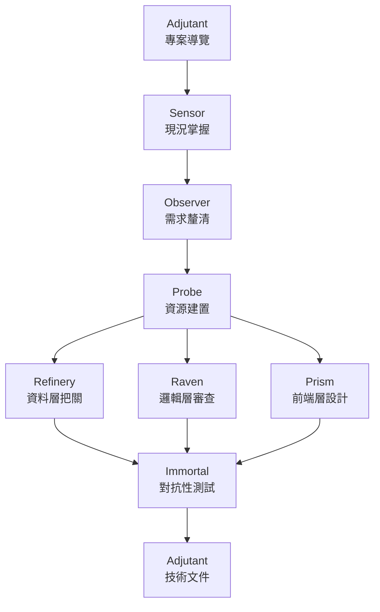
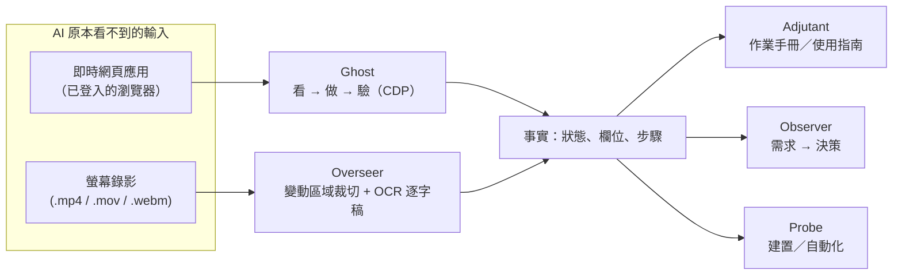
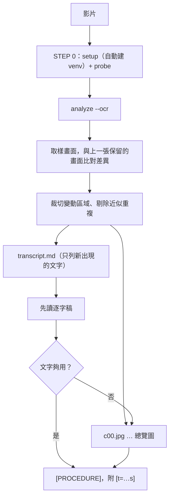
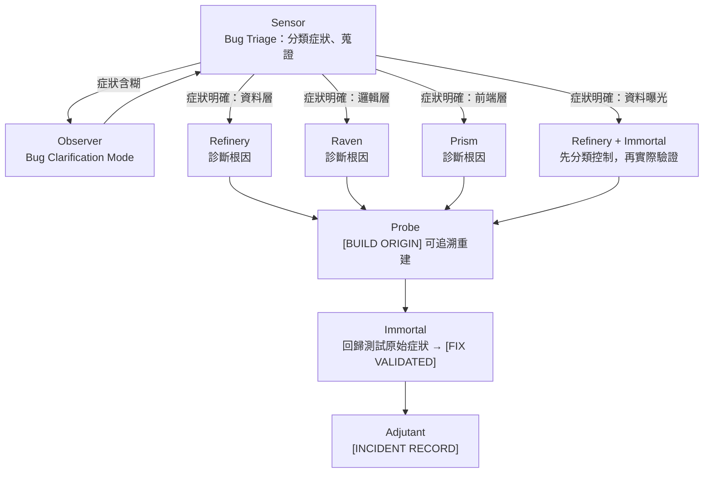

# NOVA Skill Suite — 核心起源活力助理 (Nucleus Origination Vitality Assistant)

10 個專業化的 Claude Code Skill，涵蓋任何軟體專案的完整生命週期——從需求釐清、建置、程式碼審查、資料品質、測試驗證、介面設計，到日常的現況監控、臭蟲分診、跨資源清理、資料治理與文件撰寫，另外加上兩個讓 AI 處理「原本看不到的東西」的**感官**：即時瀏覽器（`nova-ghost`）與螢幕錄影（`nova-overseer`）。適用於網頁系統、GUI 軟體、伺服器、資料庫、終端機程式與嵌入式程式。每個 Skill 均為自包含設計，可獨立使用——沒有任何一個 Skill 需要另一個先被安裝。

[English](./README.md) | **繁體中文**

---

## 使用前提

- 已安裝 [Claude Code](https://claude.ai/code) CLI
- *僅兩個附工具的 Skill 需要*（首次使用時自動安裝，不動全域環境）：`nova-ghost` 需 **Node.js 18+**；`nova-overseer` 需 **Python 3.9+**
- 具備目標專案的存取權限（原始碼、資料庫、部署環境等，依任務而定）
- 對軟體工程基本概念有基礎認識即可，**不需要任何特定平台或框架的專屬知識**——適用於任何技術棧

---

## 安裝

```bash
npx skills add github:q0015300153/nova-skills
```

**驗證**安裝是否成功：

```bash
npx skills list
```

應可在輸出中看到所有 10 個 `nova-*` Skill。

**更新**至最新版本：

```bash
npx skills update nova-skills
```

**移除：**

```bash
npx skills remove nova-skills
```

**替代方案 — 手動 clone**（適合希望自行管理檔案的場景）：

```bash
git clone https://github.com/q0015300153/nova-skills.git
```

請把整個 `skills/<skill-name>/` 資料夾（不只是 `SKILL.md`）複製到你的助理的 skills 目錄。五個 Skill 附有支援檔案：`nova-ghost` 與 `nova-overseer` 包含 `scripts/`（可自行安裝的工具）和 `references/`；`nova-adjutant`、`nova-sensor`、`nova-probe` 則在 `references/` 存放較長的範本或協定，按需讀取。只貼 `SKILL.md` 文字會導致這些 Skill 缺少所需檔案。其餘五個 Skill 為單一檔案即可使用。

---

## Skill 一覽

| Skill | 全名 | 職責 |
|---|---|---|
| `nova-observer` | Node Oracle Vector Assistant | 診斷師：當需求模糊時，把 11 個關鍵架構決策維度分成三類——**專案已經回答的**（從 `docker-compose.yml`、schema 檔、CI 設定、既有 ADR 直接讀出來）、**真正卡住的**（完整 A/B/C 提問）、**有安全預設的**（一行陳述，你一句話就能推翻）——所以它不會去問 repo 裡明明寫著答案的問題。當回報的臭蟲症狀含糊不清時，切換至 **Bug Clarification Mode** 用 8 個維度定位症狀，並自動採信 git log 與堆疊追蹤已經回答的部分，再交給對應專家或退回 `nova-sensor`。 |
| `nova-sensor` | Network Operations Visibility Assistant | 守望者：每次都重新掃描專案的真實現況，只追蹤進行中或剛變化的項目，未變動者壓成一行，並精確告知下一步該做什麼——有多條合理路徑時給出**帶後果的選項**，而不是單方面指定一條。**透過讀取其他 Skill 寫出的檔案來彙整所有未結項目**，這也是跨會話追蹤真正能運作的原因。新增 **全專案跨資源清理掃描**（找出未使用的檔案、資料表、API 端點、依賴套件等）與 **臭蟲分診（Bug Triage）**，依實際證據把問題導向正確的專家，而非僅憑症狀描述猜測。 |
| `nova-probe` | Nucleus Origination Vivification Assistant | 建造者：從任何需求出發，依照嚴謹的分層建置順序（資料儲存 → 領域模型 → 業務邏輯 → 介面 → 自動化）生成完整、可直接執行的軟體元件，動工前一定先出藍圖等你確認。確認後的藍圖會**寫入 `docs/build/<target>-blueprint.md`**，其中每個分層的 Status 欄同時就是建置記錄，讓下一次會話能直接接手。預設只納入使用情境**實際需要**的欄位（Use Case Scoping），敏感欄位一律攔截確認（`[DATA EXPOSURE REVIEW]`）；修復已知臭蟲的重建會保留完整溯源（`[BUILD ORIGIN]`）；預設一次只交付一個分層，可用「CONFIRMED — ALL AT ONCE」一次全部生成。 |
| `nova-refinery` | Node Order Viability Assistant | 精煉師：資料品質**與曝光風險**的雙重守門員——每次回應開頭都給出**兩個獨立判決**：這份資料能不能信賴、能不能曝光。設置嚴格的健康檢查與隔離機制阻止損壞、重複或垃圾資料，並把每個違規追溯到讓它進來的那個入口；同時執行正式的 **敏感度分類與存取控制建議流程**（`[SECURITY CLASSIFICATION REVIEW]`）。Schema 契約與每一項分類決定都會**寫入 `docs/data/<target>-contract.md`**——只存在於對話紀錄裡的合規決定，是無法稽核的。 |
| `nova-raven` | Negentropy Optimization Vigilance Assistant | 稽查員：無情的程式碼審查機器人，專門獵殺低效、反模式與資源洩漏，強制你在有真憑實據下才最佳化。在宣稱某個發現是「重複出現」「已解決」「回歸」之前，會**重新讀取它引用的 `file:line`**——重構會讓行號位移，過期的引用會讓還活著的臭蟲看起來像修好了。一次只處理一個根因，只回報**變動的行、絕不重貼整個檔案**，發現歷史保存在 `docs/review/<target>-findings.md`。延續自臭蟲分診的調查會保留 **起源追溯**，確保修復鏈一路連到最終的驗證與記錄。 |
| `nova-prism` | Nuance Overlay Visualization Assistant | 照明者：設計零死角的使用者介面，強制執行三層 QA（功能完整性、程式碼正確性、體驗完整性），確保交付時沒有已知的臭蟲。no-code/low-code 建構工具的 **完整手動設定指南**會寫入 `docs/ui/<surface>-config.md`，每次更新都在檔案裡整份重寫，對話只回報**改了哪幾個欄位**，絕不重貼。在任何欄位曝光到介面前執行 **敏感欄位檢查**，並明講：檢查顯示邏輯永遠證明不了控制真的有效。 |
| `nova-immortal` | Node Ordeal Validation Assistant | 不朽者：設計並實際執行**八大類**極端測試案例，其中包含 **Authorization & Data Exposure**——用一個**應該被拒絕**的角色去索取受保護資料，並斷言該值**不存在於回應中**，而不只是在畫面上看不到，且必須走遍所有存取路徑（UI、API、匯出、日誌）。可自動化的案例會被提交為真正的測試檔，讓門檻可以重跑；門檻的當前狀態與每一筆已接受風險寫在 `docs/testing/GATE.md`。當回歸測試證實先前回報的臭蟲確實已修復時，正式記錄為 **`[FIX VALIDATED]`** 並交棒建檔。 |
| `nova-adjutant` | Narrative Orientation Vault Assistant | 翻譯官：解讀混亂、難以理解的程式碼，轉譯為任何人都能讀懂的清晰文件、注釋與新人導覽指南——**寫進 repository，而不是貼在對話裡**。在宣稱文件過期之前，會同時重讀既有文件與它所描述的程式碼，讓過期的文件被明確標記而不是被默默覆蓋。新增 **事故記錄（Incident Record）**，把每次臭蟲修復的症狀、根因、修復方式、回歸測試與復發風險保存在 `INCIDENTS.md`，並在建檔前先確認這是不是某個已知根因的再次發作。 |
| `nova-ghost` | Nimble Operative Vision Assistant | 幽靈特務：透過本機 Chrome DevTools Protocol 橋接，讓 AI 操作使用者已登入的 Chromium 瀏覽器，不需要 Selenium 或 Playwright。動手前先檢查橋接與目前登入的帳號，嚴格執行**看 → 做 → 驗**迴圈，優先用 DOM 操作而非座標，遇到登入、MFA 與任何不可逆步驟就把控制權交還給人，且絕不讀取 cookie 或權杖。內附 `scripts/ensure-browser.mjs`（自動偵測或啟動專用除錯瀏覽器）與 `scripts/cdp.mjs` 與安裝／疑難排解參考文件；適用於自動化、網頁介面開發與瀏覽器端測試。 |
| `nova-overseer` | Neural Observation Video Assistant | 監察官：讓 AI 以極少的 token 看懂**螢幕錄影**（示範、教學、錯誤重現、作業流程）。不逐秒抽整張畫面，而是只保留每個時刻**畫面上有變動的區域**、剔除近乎相同的裁切，拼成少數幾張總覽圖，並可選擇產出**去除重複文字的 OCR 逐字稿**——五分鐘的錄影只剩幾張圖與一份短文字。首次使用時自動安裝獨立工具鏈（`~/.nova-overseer` 私有 venv，不需管理員權限、不動全域環境）。先讀逐字稿再決定要不要開圖，每個結論都標註時間點，僅憑 OCR 的數字標 `[⚠️ OCR ONLY]`，且絕不抄錄畫面上出現的密碼、驗證碼或個人地址。內附 `scripts/overseer.py`、冒煙測試產生器與調參參考文件。 |

---

## 各 Skill 的寫入位置

這些 Skill 會在你的 repository 裡產生實體檔案。這是刻意的設計：**任何價值就在於「以後找得到」的東西，都不能只活在對話裡**，這也是 `nova-sensor` 能跨會話回報未結項目的前提。以下路徑在專案已有既定慣例時，一律遵循既有慣例。

| Skill | 寫入位置 |
|---|---|
| `nova-adjutant` | `README.md` · `docs/<module>.md` · `docs/api/<name>.md` · `docs/adr/NNNN-<slug>.md` · `docs/runbooks/<name>.md` · `docs/ONBOARDING.md` · `docs/flows/<scope>.md` · `docs/user-guides/<scope>.md` · `INCIDENTS.md` · 原始碼內的 docstring |
| `nova-probe` | `docs/build/<target>-blueprint.md`——以及生成的原始碼本身 |
| `nova-refinery` | `docs/data/<target>-contract.md`——以及驗證／隔離邏輯所在的程式檔 |
| `nova-raven` | `docs/review/<target>-findings.md`——以及實際套用的修正 |
| `nova-immortal` | `docs/testing/GATE.md`——以及提交進版控的測試檔 |
| `nova-prism` | `docs/ui/<surface>-config.md` · `docs/ui/<surface>-qa.md`——以及元件／樣式／測試原始碼 |
| `nova-observer` | 不直接寫入——它的 `[LOCKED DECISIONS]` 交由 `nova-adjutant` 記錄為 ADR |
| `nova-ghost` | 不寫入——它負責操作瀏覽器；需要留下的紀錄交由 `nova-adjutant` |
| `nova-overseer` | 不寫入儲存庫——分析輸出放在暫存資料夾（可能含客戶資料）；它還原出的作業流程交由 `nova-adjutant` 建檔 |
| `nova-sensor` | 不寫入，唯讀——它彙整上述所有檔案 |

檔案不存在從來不是錯誤，只代表那個 Skill 還沒對這個專案跑過。

---

## 生命週期流程



---

## 感官：瀏覽器與影片

`nova-ghost` 與 `nova-overseer` 不是生命週期的某個階段——它們是讓整套 Skill 取得「原始碼裡讀不到的資訊」的管道，可供任何階段使用。



### Overseer 流程



典型用法：`python skills/nova-overseer/scripts/overseer.py analyze demo.mp4 out --ocr`，接著讀 `out/transcript.md`，再只開 `out/index.json` 列出、且文字無法說明的總覽圖。

---

## 除錯工作流程

當問題是「某個東西壞了」而非「要建置新東西」時，改走這條路徑：



若症狀本身就能對照 `nova-sensor` 自身的現況掃描直接解釋（不需要深入某一層），會由 `nova-sensor` 直接解決，不會產生不必要的交接。`nova-probe` 只在根因已確診、需要重建時才會被呼叫——它從不是除錯流程的起點。

---

## 清理與資料治理

**跨資源清理分工**：`nova-sensor` 負責全專案、跨資源類型的未使用資源掃描（檔案、資料表、API 端點、依賴套件、排程工作等）；`nova-prism` 負責單一 UI 介面**內部**的變數/元件清理；`nova-probe` 則透過 Use Case Scoping 從源頭預防過度建置。三者一律只提出建議、從不自動刪除，而且每個建議都會說明**刪掉會壞什麼、留著要付什麼代價**。

**敏感資料保護鏈**——四個步驟，各司其職：

1. **`nova-probe`** 在建置階段以共用的 Sensitivity Heuristic 偵測潛在敏感欄位，產出 `[DATA EXPOSURE REVIEW]`，每個欄位都要有明確的 Include／Exclude 決定。
2. **`nova-refinery`** 進行正式的 `[SECURITY CLASSIFICATION REVIEW]`，給出分類與具體的存取控制建議，並寫入契約記錄。
3. **`nova-prism`** 在欄位真正接進 UI 之前執行最後一道 `[⚠️ POTENTIAL SENSITIVE DATA]` 檢查——並且會明講，它能做的只有檢查顯示邏輯。
4. **`nova-immortal`** 負責證明，用一個應該被拒絕的角色、走遍每一條存取路徑去實際索取。**控制的「設定」永遠不等於控制的「效果」**——前三步是建議與檢查，只有第四步是驗證。

任何一環都需要人工明確確認才能繼續，絕不靜默放行。

---

## 設計原則

- **資源永遠以具體識別碼呈現**：檔案路徑、commit hash、ticket ID、資料表名、服務名稱等一律用 inline code 標註，絕不使用模糊代稱（No Generic Placeholder Names）。
- **狀態是讀出來的，不是記住的。** 每個 Skill 在產出任何內容前都會執行強制的 **STEP 0**，重新確認它即將宣稱的狀態——分支與 PR 狀態、CI 結果、migration 是否已套用、建議的控制是否真的生效、上一次稽核記錄了什麼。你在對話前半段做出來的東西，不能當成現在仍然為真的證據；人們會在會話之外合併、部署、刪除。**少報是排版選擇，少掃是正確性缺陷。**
- **任何需要活過這場對話的東西，都寫進檔案。** 藍圖、schema 契約、分類決定、部署門檻、已接受風險、事故記錄、發現歷史，全都有對應的 repository 路徑。印在對話紀錄裡的 ledger，下一個 session 讀不到；沒有落地的「已鎖定」決定，會被默默重新假設。若某個 ledger 的內容其他區塊已經涵蓋，就直接刪除而不是重複一份。
- **Skill 不會自動呼叫另一個 Skill**：`[WORKFLOW HANDOFF]` 僅為建議指示，需由人工決定是否切換。每個指標都必須自帶接手方需要的數字、成因或具體缺口，不能只寫「需要測試」。
- **每個推算（Dead Reckoning）都需明確用戶確認**，且所有假設值均會標記旗標，絕不靜默假設專案現況未變。STEP 0 仍會針對讀得到的部分執行。
- **`[⚠️ INFERRED]` 與 `[⚠️ VERIFY IN DOCS]` 明確區分**：前者代表基於現有專案資訊的合理推測；後者代表需要查閱官方文件才能確認的框架/工具/平台實際行為，兩者絕不混用或互相取代。
- **只回報需要行動的內容。** 通過的檢查壓成計數、未變動的發現壓成一行、未改動的交付物不會為了說明「改了一個欄位」而整份重貼。但**簡短不得藏缺口**：覆蓋範圍一定明講，而新增、嚴重或回歸的項目無論在哪種模式都強制完整展開——`nova-refinery`、`nova-raven`、`nova-prism` 把這件事形式化為 SUMMARY／FULL 兩種模式。
- **行動只出現在一個地方。** 任何只有使用者能做的事——套用、決定、部署、確認、驗證——都集中在單一的 `[NEEDS YOU]` 清單，絕不埋在發現表格或範本裡。發現負責診斷，不負責兼任待辦清單。
- **敏感資料永不靜默曝光**：在上述四步鏈中，任何疑似敏感的欄位都需要人工明確確認，而且**在通過對抗性測試之前，不算已經證明控制有效**。
- **Markdown 完整性是正確性的一部分。** 每個 code fence 都要閉合、每個表格列都要有完整欄數、每筆記錄都要完整。這些 Skill 寫出的檔案會被別人、被別的 session 讀取——截斷的表格會默默漏掉一個欄位的規則，截斷的 ledger 列會弄丟一筆已接受風險。

---

## Palantir Foundry 版本

如果你需要在 **Palantir Foundry / AIP** 上使用相同的 Skill 套件，
Foundry 原生移植版本維護於 **[q0015300153/eve-skills](https://github.com/q0015300153/eve-skills)**。

---

## 貢獻

歡迎提交 Pull Request。每個 Skill 位於 `skills/<skill-name>/`，自包含——執行階段沒有任何 Skill 會載入或依賴另一個 Skill 的定義。`SKILL.md` 放助理必須一直遵守的規則；較長的範本、指令速查與調參表放在 `references/`，按需讀取；可執行工具放在 `scripts/`，且必須能自行安裝（不得要求使用者手動設定）。Skill 之間唯一的耦合是觀察性的：`nova-sensor` 會讀取其他 Skill 寫出的產物檔案，而檔案不存在時視為「還沒跑過」，不當作錯誤。新增 Skill 請遵循命名慣例：星海爭霸單位名稱、拼出 N-O-V-A 的四個單字縮寫全名，description 以「The <單位>」開頭。

---

## 授權

[MIT](./LICENSE)
