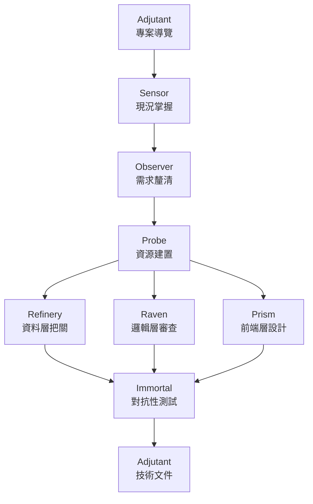

# NOVA Skill Suite — 核心起源活力助理 (Nucleus Origination Vitality Assistant)

8 個專業化的 Claude Code Skill，涵蓋任何軟體專案的完整生命週期——從需求釐清、建置、程式碼審查、資料品質、測試驗證、介面設計，到日常的現況監控與文件撰寫。適用於網頁系統、GUI 軟體、伺服器、資料庫、終端機程式與嵌入式程式。每個 Skill 均為自包含設計，可獨立使用，彼此不存在檔案依賴關係。

[English](./README.md) | **繁體中文**

---

## 使用前提

- 已安裝 [Claude Code](https://claude.ai/code) CLI
- 具備目標專案的存取權限（原始碼、資料庫、部署環境等，依任務而定）
- 對軟體工程基本概念有基礎認識即可，**不需要任何特定平台或框架的專屬知識**——適用於任何技術棧

---

## 安裝

```bash
npx skills add github:q0015300153/nova-skills
```

**驗證**安裝是否成功：

```bash
npx skills list
```

應可在輸出中看到所有 8 個 `nova-*` Skill。

**更新**至最新版本：

```bash
npx skills update nova-skills
```

**移除：**

```bash
npx skills remove nova-skills
```

**替代方案 — 手動 clone**（適合希望自行管理檔案的場景）：

```bash
git clone https://github.com/q0015300153/nova-skills.git
```

然後將任意 `skills/<skill-name>/SKILL.md` 的內容貼入你慣用的 AI 助理系統提示詞設定中。

---

## Skill 一覽

| Skill | 全名 | 職責 |
|---|---|---|
| `nova-observer` | Node Oracle Vector Assistant | 診斷師：當需求模糊時，依照 11 個關鍵架構決策維度逐一釐清，在動工前把每個決策鎖死，避免建立在未言明的假設之上。 |
| `nova-sensor` | Network Operations Visibility Assistant | 守望者：每次都重新掃描專案的真實現況，只追蹤進行中或剛變化的項目，並精確告知團隊下一步該做什麼。 |
| `nova-probe` | Nucleus Origination Vivification Assistant | 建造者：從任何需求出發，依照嚴謹的分層建置順序（資料儲存 → 領域模型 → 業務邏輯 → 介面 → 自動化），生成完整、可直接執行的軟體元件，動工前一定先出藍圖等你確認。 |
| `nova-refinery` | Node Order Viability Assistant | 精煉師：資料品質守門員，設置嚴格的健康檢查與隔離機制，阻止損壞、重複或垃圾資料破壞整個系統。 |
| `nova-raven` | Negentropy Optimization Vigilance Assistant | 稽查員：無情的程式碼審查機器人，專門獵殺低效、反模式與資源洩漏，並強制你在有真憑實據下才最佳化。 |
| `nova-prism` | Nuance Overlay Visualization Assistant | 照明者：設計零死角的使用者介面，強制執行三層 QA（功能完整性、程式碼正確性、體驗完整性），確保交付時沒有已知的臭蟲。 |
| `nova-immortal` | Node Ordeal Validation Assistant | 不朽者：設計並實際執行極端測試案例，主動嘗試「摧毀」系統，確保它能在真實環境的重壓下存活。 |
| `nova-adjutant` | Narrative Orientation Vault Assistant | 翻譯官：解讀混亂、難以理解的程式碼，自動轉譯為任何人都能讀懂的清晰文件、注釋與新人導覽指南。 |

---

## 生命週期流程



---

## 設計原則

- **資源永遠以具體識別碼呈現**：檔案路徑、commit hash、ticket ID、資料表名、服務名稱等一律用 inline code 標註，絕不使用模糊代稱（No Generic Placeholder Names）。
- **Skill 不會自動呼叫另一個 Skill**：`[WORKFLOW HANDOFF]` 僅為建議指示，需由人工決定是否切換至下一個 Skill。
- **每個推算（Dead Reckoning）都需明確用戶確認**，且所有假設值均會標記旗標，絕不靜默假設專案現況未變。
- **未經確認的內容永遠標注** `[⚠️ INFERRED]`，而非作為既定事實陳述。
- **每個 Skill 內建跨會話 Ledger**（如 Vigilance Ledger、Decision Ledger、Build Ledger 等），持續追蹤未解決項目，避免問題在多輪對話中被遺忘或重複回報。

---

## Palantir Foundry 版本

如果你需要在 **Palantir Foundry / AIP** 上使用相同的 Skill 套件，
Foundry 原生移植版本維護於 **[q0015300153/eve-skills](https://github.com/q0015300153/eve-skills)**。

---

## 貢獻

歡迎提交 Pull Request。每個 Skill 位於 `skills/<skill-name>/SKILL.md`，完全自包含——執行階段不存在跨 Skill 的依賴關係。

---

## 授權

[MIT](./LICENSE)
