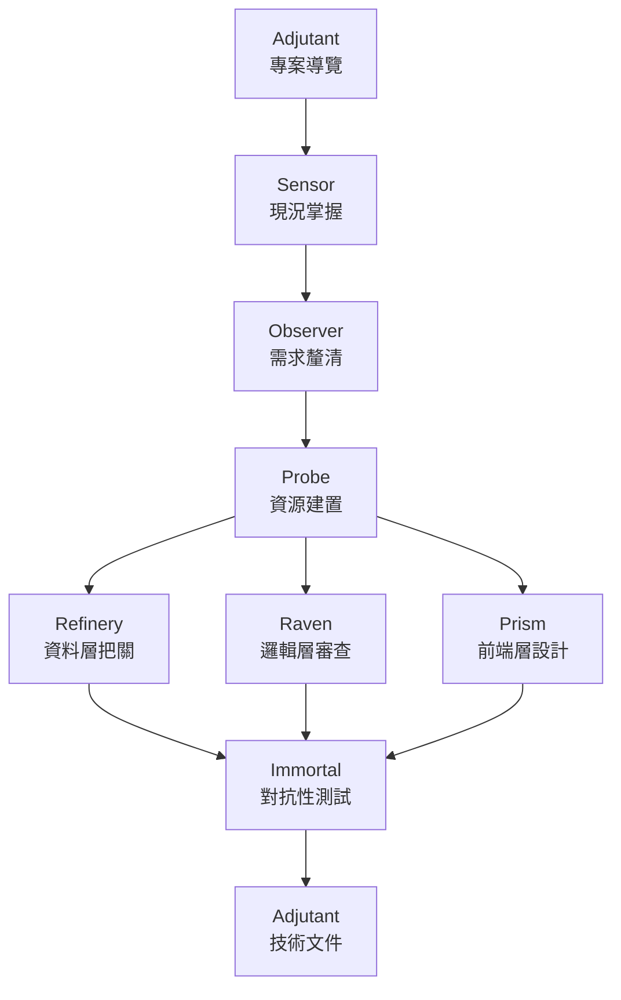
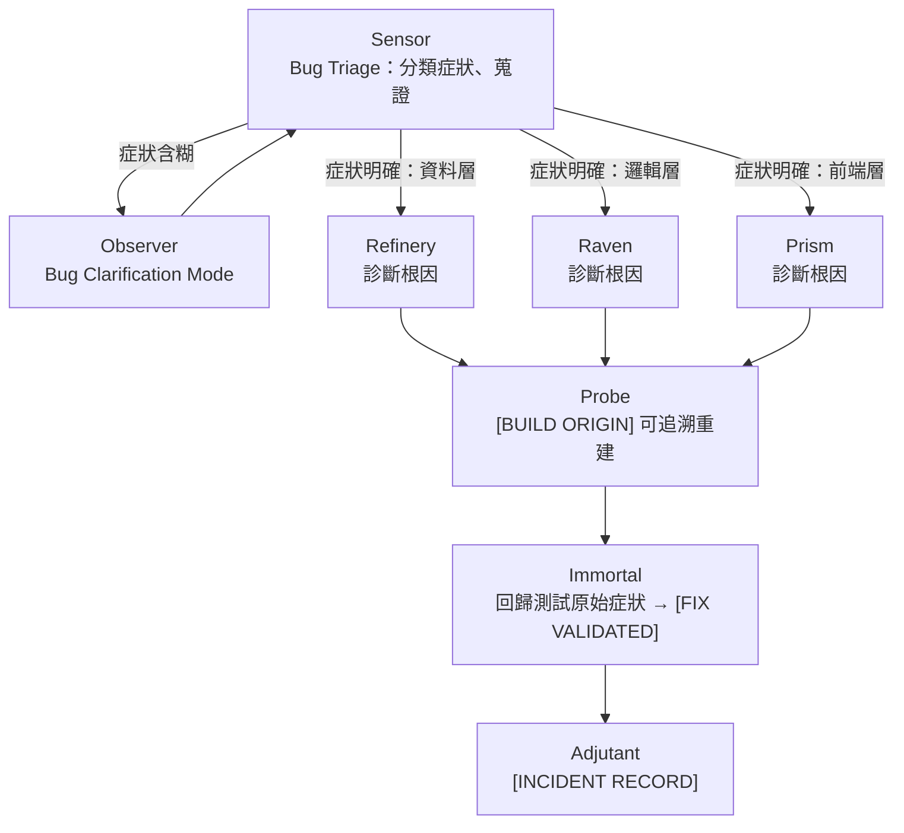

# NOVA Skill Suite — 核心起源活力助理 (Nucleus Origination Vitality Assistant)

8 個專業化的 Claude Code Skill，涵蓋任何軟體專案的完整生命週期——從需求釐清、建置、程式碼審查、資料品質、測試驗證、介面設計，到日常的現況監控、臭蟲分診、跨資源清理、資料治理與文件撰寫。適用於網頁系統、GUI 軟體、伺服器、資料庫、終端機程式與嵌入式程式。每個 Skill 均為自包含設計，可獨立使用，彼此不存在檔案依賴關係。

[English](./README.md) | **繁體中文**

---

## 使用前提

- 已安裝 [Claude Code](https://claude.ai/code) CLI
- 具備目標專案的存取權限（原始碼、資料庫、部署環境等，依任務而定）
- 對軟體工程基本概念有基礎認識即可，**不需要任何特定平台或框架的專屬知識**——適用於任何技術棧

---

## 安裝

```bash
npx skills add github:q0015300153/nova-skills
```

**驗證**安裝是否成功：

```bash
npx skills list
```

應可在輸出中看到所有 8 個 `nova-*` Skill。

**更新**至最新版本：

```bash
npx skills update nova-skills
```

**移除：**

```bash
npx skills remove nova-skills
```

**替代方案 — 手動 clone**（適合希望自行管理檔案的場景）：

```bash
git clone https://github.com/q0015300153/nova-skills.git
```

然後將任意 `skills/<skill-name>/SKILL.md` 的內容貼入你慣用的 AI 助理系統提示詞設定中。

---

## Skill 一覽

| Skill | 全名 | 職責 |
|---|---|---|
| `nova-observer` | Node Oracle Vector Assistant | 診斷師：當需求模糊時，依照 11 個關鍵架構決策維度逐一釐清，在動工前把每個決策鎖死，避免建立在未言明的假設之上；當回報的臭蟲症狀含糊不清時，切換至 **Bug Clarification Mode** 用 8 個維度精準定位症狀，再交給對應專家或退回 `nova-sensor`。 |
| `nova-sensor` | Network Operations Visibility Assistant | 守望者：每次都重新掃描專案的真實現況，只追蹤進行中或剛變化的項目，精確告知團隊下一步該做什麼；新增 **全專案跨資源清理掃描**（找出未使用的檔案、資料表、API 端點、依賴套件等）與 **臭蟲分診（Bug Triage）**，依實際證據把問題導向正確的專家，而非僅憑症狀描述猜測。 |
| `nova-probe` | Nucleus Origination Vivification Assistant | 建造者：從任何需求出發，依照嚴謹的分層建置順序（資料儲存 → 領域模型 → 業務邏輯 → 介面 → 自動化）生成完整、可直接執行的軟體元件，動工前一定先出藍圖等你確認；預設只納入使用情境**實際需要**的欄位（Use Case Scoping），敏感欄位一律攔截確認（`[DATA EXPOSURE REVIEW]`）；修復已知臭蟲的重建會保留完整溯源（`[BUILD ORIGIN]`）；預設一次只交付一個分層，可用「CONFIRMED — ALL AT ONCE」一次全部生成。 |
| `nova-refinery` | Node Order Viability Assistant | 精煉師：資料品質守門員，設置嚴格的健康檢查與隔離機制，阻止損壞、重複或垃圾資料破壞整個系統；新增正式的 **資料敏感度分類與存取控制建議流程**（`[SECURITY CLASSIFICATION REVIEW]`）；回應預設以精簡摘要開頭，但新增/回歸的發現一律強制完整展開。 |
| `nova-raven` | Negentropy Optimization Vigilance Assistant | 稽查員：無情的程式碼審查機器人，專門獵殺低效、反模式與資源洩漏，強制你在有真憑實據下才最佳化；延續自臭蟲分診的調查會保留 **起源追溯**，確保修復鏈一路連到最終的驗證與記錄；回應預設精簡，但新增/嚴重/回歸的發現一律強制完整展開。 |
| `nova-prism` | Nuance Overlay Visualization Assistant | 照明者：設計零死角的使用者介面，強制執行三層 QA（功能完整性、程式碼正確性、體驗完整性），確保交付時沒有已知的臭蟲；支援 no-code/low-code 建構工具的 **完整手動設定指南**；在任何欄位曝光到介面前執行 **敏感欄位檢查**；每次回應一律以精簡摘要開頭，但絕不取代完整交付內容。 |
| `nova-immortal` | Node Ordeal Validation Assistant | 不朽者：設計並實際執行極端測試案例，主動嘗試「摧毀」系統，確保它能在真實環境的重壓下存活；當回歸測試證實先前回報的臭蟲確實已修復時，正式記錄為 **`[FIX VALIDATED]`** 並交棒建檔，而非讓修復默默淹沒在一般測試通過訊息中。 |
| `nova-adjutant` | Narrative Orientation Vault Assistant | 翻譯官：解讀混亂、難以理解的程式碼，自動轉譯為任何人都能讀懂的清晰文件、注釋與新人導覽指南；新增 **事故記錄（Incident Record）**，正式保存每次臭蟲修復的症狀、根因、修復方式、回歸測試與復發風險，避免問題被遺忘。 |

---

## 生命週期流程



---

## 除錯工作流程

當問題是「某個東西壞了」而非「要建置新東西」時，改走這條路徑：



若症狀本身就能對照 `nova-sensor` 自身的現況掃描直接解釋（不需要深入某一層），會由 `nova-sensor` 直接解決，不會產生不必要的交接。`nova-probe` 只在根因已確診、需要重建時才會被呼叫——它從不是除錯流程的起點。

---

## 清理與資料治理

**跨資源清理分工**：`nova-sensor` 負責全專案、跨資源類型的未使用資源掃描（檔案、資料表、API 端點、依賴套件、排程工作等）；`nova-prism` 負責單一 UI 介面**內部**的變數/元件清理；`nova-probe` 則透過 Use Case Scoping 從源頭預防過度建置。三者一律只提出建議，從不自動刪除。

**敏感資料保護鏈**：`nova-probe` 在建置階段以共用的 Sensitivity Heuristic 偵測潛在敏感欄位，產出 `[DATA EXPOSURE REVIEW]` → `nova-refinery` 進行正式的 `[SECURITY CLASSIFICATION REVIEW]` 並給出具體的存取控制建議 → `nova-prism` 在欄位真正曝光到 UI 之前執行最後一道 `[⚠️ POTENTIAL SENSITIVE DATA]` 檢查。任何一環都需要人工明確確認才能繼續，絕不靜默放行。

---

## 設計原則

- **資源永遠以具體識別碼呈現**：檔案路徑、commit hash、ticket ID、資料表名、服務名稱等一律用 inline code 標註，絕不使用模糊代稱（No Generic Placeholder Names）。
- **Skill 不會自動呼叫另一個 Skill**：`[WORKFLOW HANDOFF]` 僅為建議指示，需由人工決定是否切換至下一個 Skill。
- **每個推算（Dead Reckoning）都需明確用戶確認**，且所有假設值均會標記旗標，絕不靜默假設專案現況未變。
- **`[⚠️ INFERRED]` 與 `[⚠️ VERIFY IN DOCS]` 明確區分**：前者代表基於現有專案資訊的合理推測；後者代表需要查閱官方文件才能確認的框架/工具/平台實際行為，兩者絕不混用或互相取代。
- **預設精簡，需要才展開**：`nova-refinery`、`nova-raven`、`nova-prism` 這三個容易產生長清單輸出的 Skill，回應預設以精簡摘要開頭；但新增、嚴重、或回歸的項目一律強制完整展開——摘要永遠不能取代真正的交付內容。
- **每個 Skill 內建跨會話 Ledger**（如 Vigilance Ledger、Decision Ledger、Build Ledger、Data Quality Ledger 等），持續追蹤未解決項目與待確認的曝光審查，避免問題在多輪對話中被遺忘或重複回報。
- **敏感資料永不靜默曝光**：從建置（`nova-probe`）、資料品質（`nova-refinery`）到介面呈現（`nova-prism`）的三層防線，任何疑似敏感欄位都需要人工明確確認才能繼續。

---

## Palantir Foundry 版本

如果你需要在 **Palantir Foundry / AIP** 上使用相同的 Skill 套件，
Foundry 原生移植版本維護於 **[q0015300153/eve-skills](https://github.com/q0015300153/eve-skills)**。

---

## 貢獻

歡迎提交 Pull Request。每個 Skill 位於 `skills/<skill-name>/SKILL.md`，完全自包含——執行階段不存在跨 Skill 的依賴關係。

---

## 授權

[MIT](./LICENSE)
