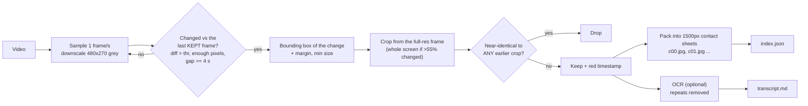

# nova-overseer — workflow, tuning, cost model

## 1. How the reducer works



Why it is cheap: comparison is against the *last kept* frame (so slow drift still triggers eventually), crops are usually a dialog or a table, not a full screen, and duplicate crops are dropped only when nearly pixel-identical to an earlier one (conservative — a missed duplicate costs a few tokens, a wrongly dropped crop loses information).

## 2. Cost model (rough, ordinary desktop recording)

| Approach | Images | Typical cost |
|---|---|---|
| 1 frame / second, full screen | 300 for 5 min | very high, mostly redundant |
| Scene-change keyframes (`frames`) | 30–60 | medium |
| `analyze` sheets + transcript | 3–8 sheets | low — read transcript first, open a sheet only when text cannot answer |

## 3. Reading order

1. `index.json` — how many sheets, which timestamps on which.
2. `transcript.md` — the story in text.
3. One sheet at a time, only for what text cannot settle.

## 4. Tuning table

| Symptom | Change |
|---|---|
| Output has 40+ crops of nearly the same dialog | `--thr 40` (or `--gap 6`) |
| A short pop-up (1–2 s) is missing | `--step 0.5 --gap 2` |
| Blinking cursor / clock / animation triggers constantly | `--thr 40`; the duplicate filter already absorbs most |
| Video is 30+ minutes | split by time first, or `--step 2` |
| Need the whole screen for one stretch | `frames <video> <dir>` and open only the relevant files |
| OCR misses small text | read the sheet instead; recordings below 1080p have a floor |

## 5. Pitfalls

| Pitfall | Handling |
|---|---|
| Video lives in OneDrive/Dropbox and opens slowly or fails | copy to a local temp folder, analyze, delete the copy |
| `cannot open video` | unusual codec; re-encode with `ffmpeg -i in -c:v libx264 out.mp4` |
| Digits misread by OCR | confirm against the sheet before recording an ID |
| Credentials visible on screen | never transcribe; write "credential entered" |
| Two windows change at once → one huge crop | falls back to whole-screen tile automatically; lower `--thr` only if detail is lost |
| Sheet files leak customer data | keep outputs in a temp folder; do not commit |

## 6. Smoke test

```bash
python <skill-dir>/scripts/overseer.py setup --ocr
<venv-python> <skill-dir>/scripts/mkdemo.py demo.mp4
python <skill-dir>/scripts/overseer.py analyze demo.mp4 out --ocr
```

Expected: 3 change moments (t≈0, 11, 21 s), 1 sheet, transcript lines `SAP Easy Access`, `Delivery 8001153201`, `Saved OK`.
`<venv-python>` is `~/.nova-overseer/venv/Scripts/python.exe` (Windows) or `~/.nova-overseer/venv/bin/python` (macOS/Linux).
